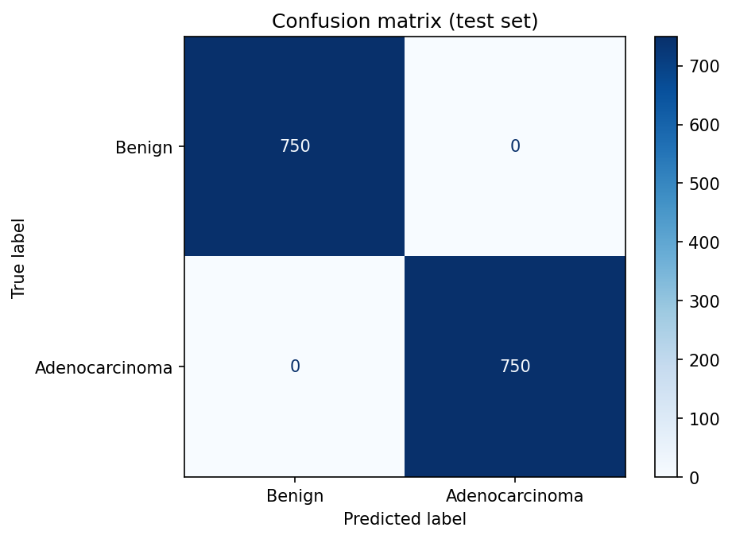
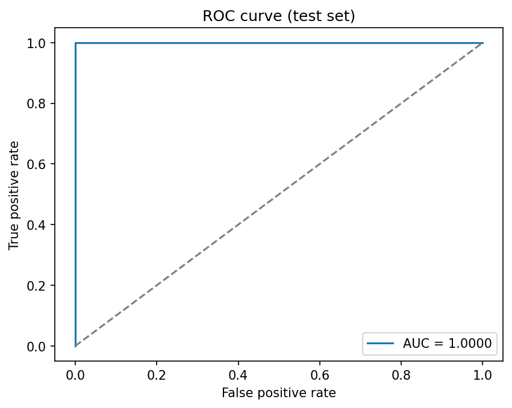

# Colon Cancer Detection from Histopathology Images

[](https://colon-cancer-detection-4mfynxys2lkiqpzwvwab44.streamlit.app) [](https://huggingface.co/Gyana23/colon-cancer-resnet18) [](https://colab.research.google.com/github/gyanasaiadusumilli/colon-cancer-detection/blob/main/notebooks/train_on_colab.ipynb)

Binary classification of colon tissue images as **benign** or **adenocarcinoma**, using OpenCV preprocessing and a transfer-learning CNN (PyTorch).

> Originally built during my undergraduate studies. Rebuilt and extended in 2026 after the original codebase was lost.

## Problem

Colorectal cancer diagnosis relies on pathologists examining H&E stained tissue slides, which is slow and subject to inter-observer variability. This project trains a model to flag adenocarcinoma in colon tissue patches as a decision-support tool.

## Dataset

[LC25000](https://www.kaggle.com/datasets/andrewmvd/lung-and-colon-cancer-histopathological-images) (Borkowski et al., 2019), colon subset:

| Class | Folder | Images |
|---|---|---|
| Benign colon tissue | `colon_n` | 5,000 |
| Colon adenocarcinoma | `colon_aca` | 5,000 |

Split: 70% train / 15% validation / 15% test, stratified, fixed seed.

**Known limitation:** LC25000 was produced by augmenting a smaller set of original images, so near-duplicate patches can land in different splits. Test scores on this dataset are optimistic compared with performance on images from a new hospital.

## Approach

1. **OpenCV preprocessing.** CLAHE on the lightness channel (LAB color space) to boost local contrast of nuclei and glands while keeping stain colors. Then resize to 224×224.
2. **Augmentation.** Random flips, 90° rotations, and mild brightness/contrast jitter to simulate staining variation. Tissue has no fixed orientation, so these are label-preserving.
3. **Model.** ImageNet-pretrained ResNet-18 (ResNet-50 and EfficientNet-B0 also supported) with a new dropout + linear head, fine-tuned end to end.
4. **Training.** AdamW, cosine learning rate schedule, cross-entropy loss. The best checkpoint is chosen on validation accuracy.
5. **Evaluation.** Accuracy, precision, recall (sensitivity), specificity, F1, ROC-AUC, confusion matrix, and ROC curve on the untouched test split.

## Results

ResNet-18 with CLAHE, trained for 8 epochs on a Colab T4 GPU. Test set: 1,500 held-out images (750 per class).

| Metric | Score |
|---|---|
| Accuracy | 1.0000 |
| Precision | 1.0000 |
| Recall (sensitivity) | 1.0000 |
| Specificity | 1.0000 |
| F1 | 1.0000 |
| ROC-AUC | 1.0000 |

Validation accuracy reached 100% after the first epoch and stayed there (see `results/history.json`).

<p float="left">
  
  
</p>

### Why a perfect score needs a caveat

A perfect score on this split does **not** mean the model would be perfect in a hospital. LC25000's 10,000 colon images were generated by rotating and flipping only 500 original images, and the dataset does not record which images share an original. With a random split, augmented copies of the same tissue sample end up in both the training and test sets, so the test set partly measures memory rather than generalisation. Published results on LC25000 commonly report 99 to 100% for the same reason.

Honest next steps, in order of value:
1. **Group-aware split:** cluster near-duplicate images (for example by image embeddings) and keep each cluster in a single split.
2. **External validation:** test on colon histology from a different source, such as NCT-CRC-HE-100K.

## Project structure

```
colon-cancer-detection/
├── app.py                 # Streamlit demo
├── deploy/streamlit/      # Streamlit Community Cloud entry point (CPU-only PyTorch)
├── notebooks/
│   └── train_on_colab.ipynb  # One-click train, evaluate and deploy
├── scripts/
│   └── split_data.py      # Stratified train/val/test split CSV
├── src/
│   ├── data.py            # OpenCV preprocessing, augmentation, Dataset
│   ├── model.py           # Transfer-learning backbones
│   ├── train.py           # Training loop
│   ├── evaluate.py        # Test metrics, confusion matrix, ROC curve
│   ├── predict.py         # Single-image inference
│   └── utils.py
└── requirements.txt
```

## How to run

**Easiest: Google Colab.** Click the "Open in Colab" badge above and run the notebook top to bottom. It downloads the data, trains on a free GPU, prints the test results, and uploads the trained model to a Hugging Face model page.

**Live demo on Streamlit Community Cloud (free):** at share.streamlit.io, create an app from this repo with main file `deploy/streamlit/app.py`. The app downloads the trained model from the Hugging Face repo set in `MODEL_REPO` (default `Gyana23/colon-cancer-resnet18`, model page: https://huggingface.co/Gyana23/colon-cancer-resnet18).

**Locally:**

```bash
pip install -r requirements.txt

# 1. Download LC25000 from Kaggle and unzip into data/
#    (expects data/lung_colon_image_set/colon_image_sets/{colon_aca,colon_n})

# 2. Create the split
python scripts/split_data.py --src data/lung_colon_image_set/colon_image_sets --out data/splits.csv

# 3. Train (a GPU helps; Google Colab or Kaggle notebooks work well)
python -m src.train --csv data/splits.csv --arch resnet18 --epochs 10

# 4. Evaluate on the test split
python -m src.evaluate --csv data/splits.csv --ckpt outputs/best_model.pt

# 5. Predict one image, or launch the demo
python -m src.predict path/to/image.jpeg
streamlit run app.py
```

To measure what CLAHE contributes, train once with `--no-clahe` and compare.

## Disclaimer

Research and educational project. Not a medical device and not validated for clinical use.
